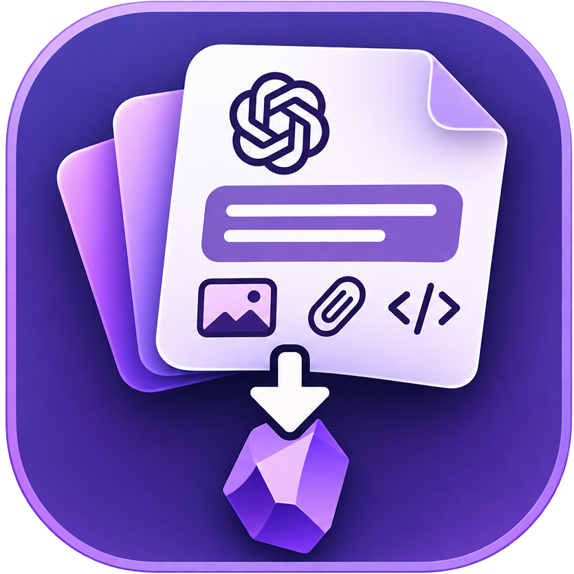

<h1 align="left">AI ChatBridge</h1>

**All your AI chats in your Obsidian vault.** AI ChatBridge mirrors your chats from **Claude**, **ChatGPT**, **Gemini**, **Google AI Studio**, **Proton Lumo** and **Hermes Agent** - plus your **Claude Code** and **Codex** sessions - into readable Markdown notes, in the same folders and projects you know from the apps. Files, images and artifacts come along too.

**And what each AI remembers about you.** Claude, ChatGPT, Claude Code and Codex each keep a memory of you between chats. AI ChatBridge saves it as dated snapshots, so you can read what is stored and see how it changes (see [AI memory](#ai-memory)).

**Part of the [Sundowna Second Brain Suite](#part-of-the-sundowna-second-brain-suite)** - an easy, low-friction second brain in Obsidian, in the spirit of Karpathy's LLM wiki. The other pieces: [OneNote Style](https://community.obsidian.md/plugins/onenote-style) (the ribbon you already know) and the [OneNote Style theme](https://community.obsidian.md/themes/onenote-style) (the look you already know).

> [!NOTE]
> **Unofficial and read-only.** Not affiliated with, endorsed by, or supported by Anthropic, OpenAI, Google, Proton or Nous Research. Nothing is ever changed or deleted on the provider's side. The plugin reads the same web endpoints your browser uses, which can change without notice.

**New in 0.37: [archived claude.ai chats](#choosing-what-to-sync)** - turn on **Include archived chats** for a Claude account and the chats you archived on claude.ai are synced too, in their normal folders. **0.34:** [Codex cloud tasks](#codex-cloud-tasks) - the tasks Codex ran in OpenAI's cloud, started on chatgpt.com/codex or from ChatGPT, saved as notes. And the plugin now loads on your phone: its sync button [asks your computer to sync](#phone-and-tablet). **0.33:** [AI memory](#ai-memory) - what Claude, ChatGPT, Claude Code and Codex keep about you, saved as dated snapshots with a privacy filter. **0.31:** better on [macOS and Linux](#windows-macos-and-linux) - the folder picker, `~` paths and where local sessions are found. **0.30:** every account shows [how its last sync went](#see-how-the-last-sync-went) - when it ran, what it saved, and why it stopped if it did. **0.29** added [Claude Code cloud sessions](#claude-code-cloud-sessions) from claude.ai/code. See the [changelog](CHANGELOG.md) for everything else.

## Contents

- [Highlights](#highlights)
- [What gets synced](#what-gets-synced)
- [Quick start](#quick-start)
- [How it looks in your vault](#how-it-looks-in-your-vault)
- [When a chat continues](#when-a-chat-continues)
- [Choosing what to sync](#choosing-what-to-sync)
- [Multiple accounts](#multiple-accounts)
- [See how the last sync went](#see-how-the-last-sync-went)
- [Desktop app sessions](#desktop-app-sessions)
- [Claude Code cloud sessions](#claude-code-cloud-sessions)
- [Codex cloud tasks](#codex-cloud-tasks)
- [Hermes Agent](#hermes-agent)
- [AI memory](#ai-memory)
- [Several computers](#several-computers)
- [Phone and tablet](#phone-and-tablet)
- [Commands](#commands)
- [Part of the Sundowna Second Brain Suite](#part-of-the-sundowna-second-brain-suite)
- [Privacy and network use](#privacy-and-network-use)
- [Requirements](#requirements)
- [Installation](#installation)
- [FAQ](#faq)
- [Development](#development)

## Highlights

- **Looks like the apps** - projects, recent chats, Claude Code groups and Codex projects become the same folders in your vault
- **Everything comes along** - files you uploaded, files the AI made, images and artifacts
- **What the AI remembers about you** - the memories and instructions that Claude, ChatGPT, Claude Code and Codex keep, as dated snapshots that are written only when something changed. Passwords, codes and card numbers are filtered out before anything is saved (see [AI memory](#ai-memory))
- **Only what's new** - each sync saves new or changed chats; moving or renaming notes in Obsidian is tracked
- **One note per chat** - when a chat continues, its note is updated to the whole chat and keeps its name, so links stay valid. The version before is kept as raw JSON, and a note you edited yourself is not lost (see [When a chat continues](#when-a-chat-continues))
- **Newest first** - a limited or stopped sync always has your latest chats
- **Pick what you want** - only selected projects, and a folder of your choice per project (e.g. your "Thesis" project straight into `10 Projects/Thesis`)
- **Several accounts per provider** - e.g. two Claude Pro accounts; they share one folder per provider and `account:` in each note tells them apart
- **Runs on its own** - automatic sync every 30 minutes or more, optional sync on startup, and it waits out "too many requests" (HTTP 429) pauses by itself
- **Stop anytime** - **Stop all** on the Overview, the ribbon, the status bar or any account's **Stop**; everything saved so far stays
- **See how it went** - every account shows its last sync: when, what was saved, and why it stopped if it did
- **Readable answers** - ChatGPT's visual answers (cards, charts, source chips) and voice chats come through as text and pictures, not "see raw JSON"

## What gets synced

| From | What | Files |
| --- | --- | --- |
| **Claude** (claude.ai) | Chats per project, archived chats optional | Artifacts and uploads |
| **Claude Code cloud** (claude.ai/code) | Sessions that ran in Anthropic's cloud, one folder per GitHub repository | Pasted images and files Claude wrote |
| **ChatGPT** | Chats per project, pinned chats included (can be turned off), archived chats optional; custom GPT chats go to `Recent` | Generated files and uploads |
| **Codex cloud** (chatgpt.com/codex) | Tasks that ran in OpenAI's cloud, started on chatgpt.com/codex or from ChatGPT; off until you turn it on | Every prompt and answer, steps counted, file changes as a diff |
| **Gemini** | Chats | Pictures as links |
| **Google AI Studio** | Chats and prompts | - |
| **Proton Lumo** | Chats and projects, decrypted on your computer | Coming |
| **Claude Code** (desktop app and CLI) | Sessions on this computer, in the same groups as the Code sidebar | Stay on your computer |
| **Codex** (ChatGPT desktop app and CLI) | Threads on this computer, per project | Stay on your computer |
| **Hermes Agent** | Chats on this computer, per Hermes profile, with every tool step | Stay on your computer |

**AI memory** is separate from chats and off until you turn it on (see [AI memory](#ai-memory)):

| From | What |
| --- | --- |
| **Claude** (claude.ai) | Claude's memory files (profile, topics, areas, people, each project's own memory) and your instructions for Claude |
| **ChatGPT** | The memory summary, the saved memories and your custom instructions |
| **Claude Code** | The global `CLAUDE.md` and every project's memory folder on this computer |
| **Codex** | The global `AGENTS.md`, the memory folders and the memory database on this computer |

## Quick start

1. Install and enable the plugin (see [Installation](#installation))
2. Open **Settings → AI ChatBridge**
3. Pick a tab - **Claude**, **ChatGPT**, **Lumo** or **Gemini** - and select **Log in**. Sign in as you would in your browser; the window closes by itself once you're in
4. Keep the default folders under `AI Chats/`, or choose your own
5. Select **Sync now**, or **Sync all** on the **Overview** tab - it shows every account and your Hermes agents at a glance, and how each one's last sync went

> [!TIP]
> **Max chats per run** starts at 3, so the first sync is a quick test. Set it to `0` (General tab) to sync everything.

Want to see what the AIs remember about you? Open the **Memory** tab, turn on the sources you want and select **Sync now** (see [AI memory](#ai-memory)).

Want local sessions too? Turn on the **Desktop app** side of a Claude or ChatGPT account for Claude Code and Codex, or a profile on the **Hermes** tab for Hermes Agent.

## How it looks in your vault

```text
AI Chats/
├── Claude/
│   ├── Chat/                          ← claude.ai chats, all accounts
│   │   ├── Recent/
│   │   │   └── 2026-11-05 Trip to Lisbon.md
│   │   └── Thesis/                    ← a claude.ai project
│   │       ├── Artifacts/…            ← files Claude made
│   │       └── Attachments/…          ← files you uploaded
│   ├── Code-Cloud/<repo>/             ← Claude Code sessions from claude.ai/code (cloud)
│   └── Code-Local/
│       └── Tower/                     ← this computer's name
│           └── my-repo/               ← sidebar group or working folder
│               ├── Artifacts/…        ← files Claude Code wrote or sent you
│               └── Attachments/…      ← images and files you attached
├── ChatGPT/
│   ├── Chat/
│   ├── Codex-Cloud/Tasks|Work/        ← Codex tasks run in the cloud
│   └── Codex-Local/
│       └── Tower/
├── Gemini/
│   ├── Chat/
│   └── AI Studio/
├── Lumo/
│   └── Chat/
└── Hermes/
    └── coder/                         ← one folder per Hermes profile

80 Archive/raw/                        ← the raw .json files, same paths as above
└── AI Chats/Claude/Chat/Recent/2026-11-05 Trip to Lisbon.json
```

Each transcript starts with properties (handy for Dataview or Bases), then the chat:

```markdown
---
account: "Main"
uuid: c_1a2b3c4d5e6f7a8b
created: 2026-09-03T09:14:54.888Z
updated: 2026-09-03T09:16:06.168Z
raw: "[[80 Archive/raw/AI Chats/Gemini/Chat/2026-09-03 Sourdough starter tips.json]]"
unread: true
---
## You · 2026-09-03 11:14

My sourdough starter smells like nail polish. Is it ruined?

## Gemini (3.6 Flash)

**No, it's just hungry.** That smell means it has used up its food. Feed it…
```

Coming from an older version? **General → Move into the new layout** shows what would move where and moves it with Obsidian's own move, so links, the sync history and the raw files follow. Folders you picked yourself stay where they are.

## When a chat continues

Each chat has one note. When you carry on with a chat after it was synced, the next sync updates that note to the whole current chat. The note keeps its name and place (also if you renamed or moved it), so links to it stay valid.

- **Earlier versions are kept** - the raw file the chat had before stays in the raw files folder as `<name> (version 2026-11-07 1951).json`, next to the current `<name>.json`. For ChatGPT's long chats the older parts are kept with it
- **The note tells you** - `updated:` is when the chat last changed, `earlier_versions:` how many earlier versions exist, and `earlier_raw:` links them:

```markdown
updated: 2026-11-09T11:03:44Z
raw: "[[80 Archive/raw/AI Chats/Claude/Chat/Recent/2026-11-06 RAM upgrade.json]]"
earlier_versions: 2
earlier_raw:
  - "[[80 Archive/raw/AI Chats/Claude/Chat/Recent/2026-11-06 RAM upgrade (version 2026-11-06 0112).json]]"
  - "[[80 Archive/raw/AI Chats/Claude/Chat/Recent/2026-11-06 RAM upgrade (version 2026-11-08 2349).json]]"
```

- **Properties you added stay** - tags, aliases and your own properties are carried over. Ticking `unread` is not an edit
- **A note whose text you changed** - by default your version is saved first as `<name> (my edits <date>).md` next to it, then the note is updated, and the sync log names it. **General → When an edited note gets an update** can instead leave such a note alone (**Don't update that note**) or replace it (**Overwrite**)
- **Desktop sessions** - a session file only grows, so the saved `.jsonl` normally just grows with it. An earlier copy is kept as a version only if the app rewrote the file. With **Keep the raw session file** off, no earlier versions are kept
- **Hermes** - each session now also gets a raw `.json` (its rows from `state.db`), so earlier versions can be kept like everywhere else
- **Deleted a note or its raw file?** The next sync writes it again under the same name

### Coming from a version that made "(updated …)" notes

Up to 0.31 a chat that continued got a second note, `<name> (updated <date>)`, and ChatGPT chats could get `(transcript …)` copies. **General → Merge chat copies into one note** (or the command of that name) tidies them up:

1. It shows a **preview**: per chat, which notes merge into which, which raw files become earlier versions and how many links change. Nothing changes until you press **Merge**. **Save preview as a note** keeps the full list
2. Per chat, the first note keeps its name and gets the newest text. Raw files of earlier versions become `(version …)` files, saved files move into the note's own `Artifacts/` and `Attachments/` folders, and links to the merged notes are rewritten to the note that stays. That includes canvases: a file card shows the note that stays, and links in text cards are rewritten like links in a note
3. The merged notes go to Obsidian's trash (the one set under **Files and links → Deleted files**), not deleted for good
4. A **report note** next to the sync log lists what was merged and any link that could not be fixed

`(transcript …)` copies and `(recovered)` notes of chats that have no `(updated …)` note are offered separately in the preview and are off until you switch them on. Notes with the same chat ID that are not named like a copy are never touched. Back up or commit your vault first.

## Choosing what to sync

- **Project folders** - one subfolder per project, or everything in one folder
- **Only sync selected projects** - fetch your project list and tick the ones you want (chats without a project are in the list too)
- **Choose a folder per project** - under **Only sync selected projects**, give any ticked project its own folder. Empty means the default, shown greyed in the field. Folders that don't exist yet are created on the next sync. Changing a folder only affects chats synced from then on - move older ones in Obsidian and the plugin keeps track
- **Download files and images** - on or off per Claude and ChatGPT account
- **Include archived chats** - claude.ai and ChatGPT keep archived chats in a list of their own, so they are left out unless you turn this on for the account (off by default). Archived chats go in their normal folder - their project, or `Recent` - not in a folder of their own. A chat you archive after it was synced stays where it is. Sessions you archive in the Claude or Codex desktop app are always synced (see [Desktop app sessions](#desktop-app-sessions))
- **Raw files folder** - all raw `.json` files in one place (`80 Archive/raw` by default), mirroring the transcript folders; switch it off to keep them next to the transcripts
- **Automatic sync** - every 30 minutes or more. After an error it pauses until you sync by hand, so nothing runs in a loop

## Multiple accounts

On any provider tab select **Add account** and give it a name, e.g. `Work`. Each account gets its own login and saves into the same folders as your other accounts, so a project you use in both ends up in one folder. Each note has `account: "Work"` in its properties.

Two accounts can share one desktop app without anything being saved twice. A session goes:

- to the account whose **Extra session folders** hold it (handy with `CLAUDE_CONFIG_DIR` or `CODEX_HOME`)
- otherwise to the account that made it - matched by Claude organization ID or ChatGPT workspace ID, which each account fills in on its first web sync
- otherwise to the first account. Claude Code sessions run only from the CLI have no login recorded, so they end up here

A session that's already saved stays with the account that saved it.

## See how the last sync went

You don't have to catch the notice to know what a sync did. Each account remembers its last run:

- **Overview** - every account card and the Hermes card have a **Last sync** line, e.g. "today 14:02: 3 new, 1 changed, 240 unchanged". Under the totals at the top, one line sums up the last **Sync all** and names any account that had a problem
- **Each tab** - the sync row of **Web**, **Desktop app**, **AI Studio** and **Hermes** shows that part's last run
- **The dot** - green: it went fine. Orange: you stopped it, it is waiting out a ChatGPT cooldown, no projects were selected, or Hermes profiles were not found. Red: it failed, with the reason
- Automatic syncs are marked "(automatic)". Only counts and the stop reason are kept (in the computer's own file in the plugin folder), never chat text

## Desktop app sessions

Some chats only live on your computer: Claude Code sessions from the Claude desktop app and CLI (`~/.claude/projects`) and Codex threads from the ChatGPT/Codex desktop app and CLI (`~/.codex/sessions`). AI ChatBridge saves those too, one note per session.

- Titles and folders match the apps' sidebars. Claude Code sessions go in one folder per sidebar group (otherwise per working folder), with forks and side sessions nested under the session they came from. Codex threads go in one folder per project, or `Recent`
- Their files come along: images and files you attached go to `Attachments/`, and documents Claude or Codex wrote or sent you (Markdown, HTML, PDF, Office files, images) go to `Artifacts/`, next to the note. Each file is copied in its latest version. Source code and the assistants' own scratch files are left out, and notes already in your vault are linked, not copied. Artifacts and Claude Docs published on claude.ai are listed as links. Turn this off with General → **Save session files**
- Sessions still running wait until they have been quiet for a while (15 minutes by default)
- Archived sessions are synced too, in their usual folder: the Claude desktop app only hides them in its sidebar and keeps the session file, and Codex moves them to `~/.codex/archived_sessions`, which is read as well. A session archived after it was synced keeps its note
- Session files somewhere else? Add the folder under **Extra session folders** (on macOS and Linux a leading `~` is your home folder)
- Claude Cowork sessions are kept in the cloud, not on your computer, so they can't be read locally

## Claude Code cloud sessions

Sessions that ran in Anthropic's cloud - on claude.ai/code, or started from the Claude phone app - are saved with the claude.ai sync, into the **Code Cloud folder** (`Claude/Code-Cloud/<repo>/`), one subfolder per GitHub repository.

- The note says `app: "Claude Code (cloud)"`, names the `repo:` and links back to the session on claude.ai. The raw `.json` holds every event
- Pasted images go to `Attachments/` and files Claude wrote in full to `Artifacts/`
- A session that is still running is saved once it's done. A session that goes on later updates its one note; the version before stays as raw `.json`
- Sessions you steered from claude.ai but that ran on your computer (Remote Control) are left to **Code Local**, so nothing is saved twice
- On by default. Turn it off per account with **Claude Code cloud sessions** in the Claude tab

## Codex cloud tasks

Tasks that Codex ran in OpenAI's cloud are saved with the ChatGPT sync, into the **Codex Cloud folder**: those started on chatgpt.com/codex in `ChatGPT/Codex-Cloud/Tasks/`, those started from ChatGPT (on the web, the phone, or a schedule) in `ChatGPT/Codex-Cloud/Work/`.

- **Off until you turn it on**: ChatGPT tab → **Codex cloud tasks**. It uses the ChatGPT login the chat sync already has
- The note says `app: "Codex (cloud)"`, names the `model:` and where the task was `started_from:`, and links back to it on chatgpt.com. It holds every prompt and Codex's answers, with the steps in between counted (like local Codex threads). Then comes the error if the last turn failed, and - with **Keep Codex's steps** on - the files Codex changed with a folded diff. A diff over 200,000 characters stays in the raw `.json` only
- A scheduled run is named after its schedule ("Agriland Market Watch"), not after its instructions
- The raw `.json` keeps the conversation: your messages and Codex's answers, with each run of steps in between counted ("7 commands, 2 tool calls"). Scheduled runs can take thousands of steps with megabytes of output; turn on **Keep Codex's steps** to keep them all anyway (command output and tool results over 50,000 characters are then cut, marked "[cut N characters]"), and to get the changed files as a diff in the note
- A task that is still running is saved once it is done. A follow-up updates its one note; the version before stays as raw `.json`
- How it works: Codex on chatgpt.com keeps a live connection to `codex-cloud-backend.chatgpt.com`. The plugin opens the same connection with your ChatGPT login and only reads: the task list, each task's turns and its steps. It refuses to send anything that would start or change a task

## Hermes Agent

[Hermes Agent](https://github.com/NousResearch/hermes-agent) by Nous Research keeps every chat in a SQLite database, one per profile: `state.db` in your Hermes home folder, and `profiles/<name>/state.db` for each named profile. Chats can come from any model - Claude, GPT, a local Qwen - and each note records which one.

1. Open the **Hermes** tab. Your profiles are found by themselves (`HERMES_HOME`, else the default Hermes folder) and listed **turned off**
2. Turn on the profiles you want. Missing one? **Add by path** and point it at the folder that holds `state.db`, or select **Refresh** after adding a profile in Hermes
3. Select **Sync** next to a profile, **Sync now** for all of them, or run **Sync Hermes Agent chats**. **Sync all** includes them too

Deleted a profile in Hermes? It moves to **No longer found** at the bottom of the list and the sync skips it. Its notes stay in the vault. Leave it on if it may come back, or select **Remove**.

Each chat lands in `AI Chats/Hermes/<profile>/` with `source: hermes`, `hermes_profile`, `model` and `session_id` in its properties, dates as `YYYY-MM-DD`. Tool calls appear as a collapsed callout you can open:

```markdown
## Hermes · 2026-11-10 21:49

> [!example]- 3 tool steps
> **1. read_file**
> ~~~json
> { "path": "notes/garden.md" }
> ~~~
> Result:
> ~~~
> # Garden plan …
> ~~~

Lettuce, spinach and chard do well in the shade.
```

Long arguments and results are shortened (600 and 1,200 characters), so notes stay readable.

**Left out:** helper (subagent) sessions unless **Include helper sessions** is on, sessions active in the last few minutes (they come with the next sync), and anything run in - or mentioning - a folder named `Private`.

**How it reads, safely:** Hermes may be writing while you sync, and its newest messages can still sit in `state.db-wal`. So the plugin never copies the files or opens them for writing. Each sync opens `state.db` read-only, takes a consistent snapshot with SQLite's backup function into a temporary file, reads that copy and deletes it. It uses Obsidian's built-in SQLite; if your Obsidian has none, it uses Python instead - Hermes' own, or one on your computer (set it under **Hermes → Advanced → Python**).

## AI memory

An AI does not start from zero in every chat. It keeps things *about you*: a profile, your projects, the people you mention, how you like your answers. You rarely see this, and it changes without telling you.

The **Memory** tab saves it into your vault as dated snapshots. You can read what each AI has stored, search it like any other note, and see what changed from one snapshot to the next.

- **Four sources:** Claude and ChatGPT on the web, Claude Code and Codex on this computer
- **One note per AI and account**, in the AI's own words and its own structure
- **Only when something changed:** a sync with no change writes nothing
- **Privacy filter:** passwords, codes, ID and card numbers are replaced before anything is saved
- **Read-only:** nothing is changed or deleted on the provider's side or in the AI's own files

### What is read

Every source is **off** until you turn it on.

| Source | What is read |
| --- | --- |
| **Claude** (claude.ai, per account) | Every **memory file** Claude keeps: `/profile.md`, topics, areas, people, and each project's own memory (shown as `/projects/<project name>/…`), plus your **instructions for Claude** |
| **ChatGPT** (chatgpt.com, per account) | The **memory summary** with ChatGPT's own section headings, the **saved memories** (date and text, newest first) and your **custom instructions** |
| **Claude Code** (this computer) | `~/.claude/CLAUDE.md` and every project's memory folder, `~/.claude/projects/*/memory/`. `CLAUDE_CONFIG_DIR` is used if set |
| **Codex** (this computer) | `~/.codex/AGENTS.md`, everything in `~/.codex/memories/` and `~/.codex/memories_v2/`, and the per-thread notes in Codex's memory database (`memories_*.sqlite`). `CODEX_HOME` is used if set |

Claude and ChatGPT are read with the login you already use for syncing chats, so there is nothing extra to sign in to. With several accounts, each account has its own switch and its own folder.

### Turn it on

1. Open **Settings → AI ChatBridge → Memory**
2. Set the **Memory folder** (default `AI Memory`)
3. Turn on the sources you want: under **On this computer** for Claude Code and Codex, under **On the web** for each Claude and ChatGPT account
4. Select **Sync now**, or run the command **Sync AI memory**

Optionally set **Automatic memory sync** (0 is off, minimum 30 minutes). **Sync all** does not include AI memory.

### What you get

One folder per AI and account. For Claude and ChatGPT the account is the account's name in the plugin; for Claude Code and Codex it is this computer's name.

```text
AI Memory/
  Claude/
    Personal/
      2026-11-16.md        <- a snapshot, never changed again
      2026-11-19.md        <- written because something changed
      _latest.md           <- always the current state
    Work/
      …
  ChatGPT/
    Main/
      …
  Claude Code/
    Tower/
      …
  Codex/
    Tower/
      …
```

A snapshot is written only when something changed since the last one. A second change on the same day is saved as `2026-11-19 (1432).md`. `_latest.md` is the one file that is overwritten, so a link to it always shows the current state.

Each note starts with its properties: `provider`, `account`, `source` (`local` or `web`), `synced`, `hash` (SHA-256 of the text below the properties) and `files`, plus `redacted` when the privacy filter replaced something. Then comes a list of what was read, then one heading per memory file with its text in a code block.

**Claude** keeps memory as files, so the note has one heading per file, under the file's own path:

````markdown
- `memory files`: 20 files, 11 of them in 3 projects
- `instructions for Claude`: 1 field with text

## /profile.md

```markdown
---
name: profile
description: Who the user is
---

Runs a small garden centre. Writes in English and German.
```

## /projects/Garden shop/preferences.md

```markdown
Kurze Antworten. Preise immer in CHF.
```
````

**ChatGPT** keeps a summary, a list of saved memories and your custom instructions, so the note has these three parts:

````markdown
- `memory summary`: 6 sections
- `saved memories`: 41 memories
- `custom instructions`: no text set

## /memory-summary

```markdown
## Overview

You run a small garden centre and are building its website.

## Tools And Workflows

You use a Windows PC and keep your notes in Obsidian.
```

## /saved-memories

```text
[2026-11-11] Prefers prices in CHF with a space after the currency.

[2026-09-08] Wants the file name as a comment on the first line of any code.
```
````

**Claude Code** and **Codex** notes look the same as Claude's: one heading per memory file, such as `/projects/D--Work-garden/memory/beds.md`.

The code block is there so nothing is reformatted: a memory file's own headings and `---` lines stay exactly as they are. **Nothing is translated or corrected.** You see what the AI keeps, in whatever language it keeps it. One thing is evened out: Windows line ends are saved as plain line ends, because Obsidian would change them anyway the first time you open the note.

### Privacy filter

On by default, with a switch in the Memory tab. Before a snapshot is written, these are replaced with `[REDACTED]`:

| Kind | How it is found |
| --- | --- |
| Passwords, PINs, secret keys and tokens | By their label, in English, German and Afrikaans: `Passwort: …`, `wagwoord is …`, `API key: …` |
| 2FA seeds | `otpauth://` links, and seeds after a label such as `2FA secret:` |
| Recovery and backup codes | The codes on the line that names them and in the list directly below |
| ID numbers | By label (`Reisepass Nr.: …`, `ID number: …`), and Swiss AHV numbers by their shape |
| Card numbers and IBANs | By shape plus checksum, so phone and order numbers are left alone |

Only the value is replaced; the label and the rest of the line stay (`Passwort: [REDACTED] (für den Router)`). The sync log names the kind and the memory file, never the value. The note says how many values were replaced.

> [!WARNING]
> The filter works from labels and checksums. It can miss something written in an unusual way, and it can replace a harmless word after `password:`. It does not replace names, email addresses or phone numbers. Do not rely on it alone.

Turn it off to save everything exactly as the AI keeps it; the next sync then writes a new snapshot if that changes the text.

### How it reads, and what it leaves out

- **Only reading.** The AI's own files are never changed, and nothing is changed or deleted on claude.ai or chatgpt.com
- **Claude:** the memory files are listed and read with the two read requests claude.ai's own memory page uses. The plugin can call only those two
- **ChatGPT and the summary:** everything on chatgpt.com is read with GET requests, except the memory summary, which ChatGPT only hands out the way its settings page asks for it (an empty POST). The plugin sends that request without any content, so it cannot ask for changes. If ChatGPT's stored summary is out of date, ChatGPT may write a fresh one first, exactly as when you open **Settings → Personalization → Memory summary** yourself. Saved memories are never edited or deleted
- **Codex's memory database** is read the same way as Hermes' database: from a read-only snapshot in a temporary file that is deleted afterwards
- **Left out:** folders named `Private` (and Claude Code projects with `Private` as a part of their name) are never read, and the memory folder cannot be inside one. Files larger than 2 MB or not text are named, not copied. Codex's use counters and ChatGPT's per-memory status are left out, because they change without the memory changing and would cause a new snapshot each time
- **If an answer looks different from what the plugin knows,** the read stops and nothing is saved for that account, so a snapshot is never half-written

## Several computers

You can keep one vault on several computers and sync it between them with any file syncing app, even one that copies everything including `.obsidian` (Proton Drive, Syncthing, Obsidian Sync). Whichever computer you are on syncs everything itself; none has to stay switched on for the others.

- **Settings are shared, history is not.** `data.json` holds only what you set, and changes only when you change a setting. What each computer synced goes to a file of its own, `computers/<computer name>.json` in the plugin folder, together with its own folders (extra Claude Code and Codex session folders, Hermes profiles). Two computers never write the same file
- **No chat is fetched twice.** Before each sync the plugin reads what the other computers saved. A chat Tower saved yesterday is known on the laptop, so it is not fetched again and no second note is written. Claude Code, Codex and Hermes sessions stay with the computer they are on, in its own folder (`Code-Local/<computer>/…`)
- **One at a time.** While a sync runs, a small file says which computer is syncing. If you start a sync on another computer meanwhile, it asks whether to wait or sync anyway; automatic syncs just wait. The last-sync lines say "on Tower" when another computer ran them, and **General → Computers** lists the others
- **Each computer signs in once** per account: logins live in that computer's Obsidian, not in the vault
- **New computer:** let the file syncing app finish copying the vault before the first sync there. A chat whose note has not arrived yet would otherwise be written again, and the syncing app would then keep two copies

## Phone and tablet

The plugin loads in Obsidian on Android and iOS, but a phone does not sync by itself yet: the login windows and the local sessions only exist on a computer. Instead the phone **asks your computer to sync**, through two small files in the vault. Whatever carries your vault between the devices (Syncthing, Obsidian Sync, …) carries them too; there is no other connection and no extra service.

1. On the phone, select the sync icon in the ribbon menu, or run **Sync: here, or ask the computer** (you can add it to the mobile toolbar). The plugin writes `sync-request.json`.
2. Your computer sees the request once your vault sync has delivered it, runs **Sync all**, and writes `sync-status.json` with what it did: the result and the counts per account, never a login.
3. The phone tells you when the computer has started and when it is done, and the Overview shows "Last synced by Tower today 14:02 …".

How long step 2 takes depends only on your vault sync: seconds when both devices are online, much longer when the phone's sync app is asleep.

**Setting it up** (General tab, **Sync from another device**):

- **Folder for sync requests** - must be the same on every device, and your vault sync must carry it in both directions. `.json` files need **Sync all other types** if you use Obsidian Sync. Don't use a folder starting with a dot
- **This device** - a computer **syncs** (writer) by default, a phone or tablet **asks** (requester). A second computer can be set to ask too. The role and the device's name are saved on the device itself, not in the synced settings
- **Ignore requests older than (hours)** - a request that took longer than this to arrive is not run (default 12)

The computer runs each request once, at most one requested sync every two minutes, and never interrupts a sync that is already running: the request waits for it. Obsidian has to be open on the computer.

**Test mobile connection** is a first step towards syncing on the phone itself: it checks whether the phone can reach claude.ai and ChatGPT with a session key or cookie pasted there, and shows the status, the content type and whether a Cloudflare check page came back. Nothing is saved and no key is shown.

## Active Context

When you switch between AIs (one account hits its limit, you continue in another or in Codex), the next AI needs to know where things stand. Turn on **General → Active Context** and choose a **Handoff folder** (default `_AI Handoff`). The plugin keeps a note `Active Context.md` there, made with five empty parts (Plan, Now, Waiting for you, Next up, Recently done) if you don't have one yet. Ask your AIs to read it first and keep "Now" and "Recently done" current. The plugin then:

- writes a **Live sessions** list into the note after every sync: the chats active in the last 48 hours, newest first, each with a link to its transcript and your last request. When one account hits its limit, the next AI finds the chat there. The list sits between two markers and is replaced each time, so don't edit it;
- once a day, moves "Recently done" lines older than 7 days to the monthly archive (`Handoff archive/_YYYY-MM.md`), word for word;
- asks under "Waiting for you" about a "Now" line that has stayed for 3 days: finish it, move it to Recently done, or drop it.

**Hand over a chat to another AI** puts a ready message on the clipboard: which chat, where its transcript is in the vault, when it was last synced, and your last request. Paste it into the other account or Codex. Right-click a synced chat note for **Hand over this chat**.

### System files start with "_"

The plugin's own files are named so you can leave them out of the graph and searches: the log `_ai-chatbridge-log.md`, reports `_ai-chatbridge-merge-report-….md` and the folder `_ai-chatbridge-diagnostics`. When you update from an older version, the old ones are renamed once, through Obsidian, so links keep working. A log you named yourself keeps its name.

## Commands

| Command | What it does |
| --- | --- |
| **Sync: here, or ask the computer** | The sync button as a command: a device that syncs runs **Sync all** (or stops the running sync), a device that asks writes a request for your computer. See [Phone and tablet](#phone-and-tablet) |
| **Sync all chats** | Every account you're logged in to, then the desktop apps and Hermes profiles that are on |
| **Sync Claude (claude.ai and Claude Code)** | All claude.ai accounts you're logged in to, then Claude Code on this computer for every account that has it on |
| **Sync ChatGPT (chats and Codex)** | All ChatGPT accounts you're logged in to, then Codex on this computer for every account that has it on |
| **Sync Gemini and AI Studio chats** | All Google accounts you're logged in to - Gemini chats, then AI Studio prompts |
| **Sync Lumo chats** | All Proton Lumo accounts you're logged in to |
| **Sync desktop app chats (Claude, Codex)** | Local Claude Code and Codex sessions |
| **Sync Hermes Agent chats** | The Hermes profiles that are on |
| **Sync AI memory** | A snapshot of what Codex, Claude Code, Claude and ChatGPT keep about you, for the sources that are on in the **Memory** tab. Writes nothing if nothing changed |
| **Reconcile all ChatGPT chats** | Check all ChatGPT chats again, not just recent changes |
| **Stop the running sync** | Stops after the current chat - so do **Stop all** on the Overview, the ribbon icon, the status bar text and **Stop** in the settings |
| **Cancel pending chat sync retry** | Stop a waiting retry after a 429 pause |
| **Refresh index: find synced notes moved outside the app** | Finds notes you moved in the file manager (or while the plugin was off) by their chat ID, so the next sync doesn't save them twice |
| **Merge chat copies into one note (preview first)** | For vaults from before one note per chat: merges each chat's `(updated …)` notes into its first note, keeps earlier versions as raw files and rewrites links. Shows a preview; nothing changes until you confirm |
| **Move synced chats into the new folder layout** | Moves folders from older versions into `Claude/…`, `ChatGPT/…` - links, the sync index and the raw files follow |
| **Diagnose: save claude.ai answers for the open chat** | Saves the raw answers of the open chat, for bug reports |
| **Update Active Context now (live sessions, archive, stale lines)** | Runs the Active Context upkeep now. See [Active Context](#active-context) |
| **Hand over a chat to another AI (copies a ready message)** | Pick a recent chat; a message for the next AI (where the transcript is, how fresh it is, your last request) goes to the clipboard |
| **Test mobile connection** | One request each to claude.ai and ChatGPT with the pasted logins; reports status, content type and whether a Cloudflare check page came back |

## Part of the Sundowna Second Brain Suite

This is one of three pieces of the **Sundowna Second Brain Suite (SSBS)**. Together they turn Obsidian into a second brain that feels like home: your knowledge in plain Markdown that you own, with tools that work like the ones you already use.

| Piece | Kind | What it does | Get it |
|---|---|---|---|
| **AI ChatBridge** (you are here) | Plugin | Brings your chats from Claude, ChatGPT, Gemini and others into the vault as Markdown | [Obsidian community](https://community.obsidian.md/plugins/ai-chatbridge) |
| [**OneNote Style**](https://github.com/Sundowna/obsidian-onenote-style) | Plugin | The ribbon you already know: Office-style tabs, groups and buttons for any command, plus note tags, subpages and editing without Markdown syntax. Its **AI** group runs AI ChatBridge's sync commands with one click | [Obsidian community](https://community.obsidian.md/plugins/onenote-style) |
| [**OneNote Style theme**](https://github.com/Sundowna/obsidian-onenote-theme) | Theme | OneNote's look: white pages, Calibri, OneNote's heading styles, light and dark | [Obsidian community](https://community.obsidian.md/themes/onenote-style) |

Each works on its own. Together they are low friction from the first minute.

## Privacy and network use

This plugin needs network access for the web providers. Please read this before using it.

- **Services contacted:** `claude.ai`, `chatgpt.com`, `gemini.google.com`, `aistudio.google.com` (with its API host `alkalimakersuite-pa.clients6.google.com`) and `lumo.proton.me`, plus their login pages, e.g. `auth.openai.com`, `accounts.google.com` and `account.proton.me` - only when you log in or sync. Nothing is sent anywhere else. No telemetry
- **What is sent:** the same requests your browser sends to list and read your own chats and files, with your login
- **Accounts:** you need your own account with each provider you sync
- **Login windows:** a normal sign-in page in a window of its own, locked down - pages opened there can't use your camera, microphone, location, notifications or connected devices
- **Where logins are stored:** in each login window's own storage on this computer, outside the vault, separately per account. Never in `data.json`, notes or logs. **Log out** and **Remove** in the settings clear them
- **Account identifiers:** the name you give an account, and its claude.ai organization ID or ChatGPT workspace ID, are stored in `data.json` - these are not secrets
- **Pasted login fallback (claude.ai, ChatGPT, Gemini and AI Studio):** if the login window doesn't work, you can paste a login cookie from your browser under the account's advanced settings (see the [FAQ](#faq)). It's kept in Obsidian's secret storage on this computer - never in the vault, `data.json`, notes or logs - and the login window wins if both are set. Google's cookies only go into a separate hidden window kept in memory, which is emptied after each sync. Lumo has no fallback: unlocking its encrypted chats needs keys only its login window holds
- **Gemini and AI Studio:** Google has no API for either, so the plugin opens them in a hidden window with your Google login and reads the same data their own pages load. Requests are signed inside that page the way the page signs its own - no Google token is saved or logged. Google blocks logins from windows inside apps, so the Google login window says it's Firefox
- **Proton Lumo:** Lumo stores chats end-to-end encrypted. To sync them, the plugin opens Lumo in a hidden window with your login and unlocks your keys for that one sync - the keys stay in memory and are never saved or logged. The chats are then saved **readable** in your vault, so anything that can read your vault can read them
- **ChatGPT's visual answers:** turned into plain HTML and pictures in your notes - nothing from a chat is ever run, and drawings can't load anything from other websites
- **What is written:** transcripts, raw JSON, downloaded files and a sync log - only in the vault folders you choose. The sync index (in each computer's own file in the plugin folder, see [Several computers](#several-computers)) holds chat IDs and paths, no chat content and no secrets
- **Files outside the vault (desktop apps and Hermes only):** the plugin *reads* local files only for what you turn on - for Claude Code and Codex: `~/.claude/projects`, the Claude desktop app's session list and Local Storage (for titles and sidebar groups), `~/.codex/.codex-global-state.json`, `~/.codex/sessions`, `~/.codex/archived_sessions`, `~/.codex/session_index.jsonl` and any extra folders you add; for Hermes: the `state.db` of each profile that is on. It never changes them and sends nothing over the network. Hermes snapshots are written to your system's temporary folder and deleted right after reading; if Obsidian has no built-in SQLite, a Python on your computer is started to make them. Hermes tool results can contain file contents, so they are shortened in the notes and steps mentioning a `Private` folder are left out
- **AI memory, Claude (only for the accounts you turn on):** asks claude.ai for the list of memory files, each file's text, the names of the projects that have memory, and your instructions for Claude, with the same login as the chat sync. Listing and reading memory files are requests that only read (claude.ai asks for them with POST, like its chat view). Nothing is changed there
- **AI memory, ChatGPT (only for the accounts you turn on):** asks chatgpt.com for the memory summary, the saved memories and the custom instructions, with the same login as the chat sync. It changes nothing there (see [AI memory](#ai-memory) for the one request that is not a GET). Saved memories can hold names and email addresses; the privacy filter does not replace those
- **AI memory, on this computer (only for the sources you turn on):** reads `~/.codex/AGENTS.md`, `~/.codex/memories`, `~/.codex/memories_v2` and `~/.codex/memories_*.sqlite` for Codex, and `~/.claude/CLAUDE.md` and `~/.claude/projects/*/memory` for Claude Code. It never changes them and sends nothing over the network. The text is saved readable in your vault, so anything that can read your vault can read it. The privacy filter replaces passwords, recovery codes, 2FA seeds, ID numbers and card numbers it recognises with `[REDACTED]`, but it can miss some
- **Terms of service:** automated access may be limited by the providers' terms. Keep a reasonable delay between requests and use your own judgment

## Requirements

- Obsidian **1.11.4** or newer
- **Syncing needs a computer** (Windows, macOS, Linux) - the login windows need Electron, and local sessions are read from your computer's disk. On Android and iOS the plugin can ask your computer to sync: see [Phone and tablet](#phone-and-tablet)

### Windows, macOS and Linux

The plugin works the same on all three. Where it looks for local sessions:

| | Windows | macOS | Linux |
|---|---|---|---|
| Claude Code sessions | `~/.claude/projects` | `~/.claude/projects` | `~/.claude/projects` |
| Codex threads | `~/.codex/sessions` | `~/.codex/sessions` | `~/.codex/sessions` |
| Claude desktop titles and groups | `%LOCALAPPDATA%/Claude`, `%APPDATA%/Claude` | `~/Library/Application Support/Claude` | `$XDG_CONFIG_HOME/Claude`, else `~/.config/Claude` |
| Hermes profiles | `HERMES_HOME`, `%LOCALAPPDATA%/hermes`, `~/.hermes` | `HERMES_HOME`, `~/.hermes` | `HERMES_HOME`, `~/.hermes` |

`CLAUDE_CONFIG_DIR` and `CODEX_HOME` are followed on every system. Folder names of local sessions use your computer's own name, without the network ending (`Walters-MacBook`, not `Walters-MacBook.local`). The macOS and Linux parts are covered by automatic tests on all three systems; if something is off on yours, please [open an issue](https://github.com/Sundowna/obsidian-ai-chatbridge/issues).

## Installation

**From Community plugins:** **Settings → Community plugins → Browse**, search for **AI ChatBridge**, then **Install** and **Enable**. Or open [AI ChatBridge on the Obsidian community site](https://community.obsidian.md/plugins/ai-chatbridge).

**Manually:**

1. Download `main.js`, `manifest.json` and `styles.css` from the [latest release](https://github.com/Sundowna/obsidian-ai-chatbridge/releases/latest)
2. Copy them into `<your vault>/.obsidian/plugins/ai-chatbridge/`
3. Reload Obsidian and enable **AI ChatBridge** in **Settings → Community plugins**

## FAQ

**My first sync is taking forever?**

That's the 429s: with 1,000+ chats the providers start saying "too many requests". The plugin pauses, shows a countdown in the status bar and carries on by itself. Still a lot faster than waiting for a data export.

**The login window doesn't work for me?**

Use the pasted login fallback. Sign in to the site in your browser and open DevTools (**F12**), then:

- **claude.ai:** **Application → Cookies**, copy the value of `sessionKey`
- **ChatGPT:** **Application → Cookies**, copy the value of `__Secure-next-auth.session-token` - or, if ChatGPT split it into `.0` and `.1`, go to **Network**, select a `chatgpt.com` request and copy its whole `Cookie` header
- **Gemini and AI Studio:** **Network**, select a `gemini.google.com` request and copy its whole `Cookie` header

Paste it under the account's advanced settings in the plugin. Pasted cookies run out sooner than a login - Google's especially - so paste a fresh one when the sync says it expired.

**Can I edit the synced notes?**

Better not - treat them as the originals. Delete one and the next sync puts it back, under the same name. Write your own notes elsewhere and link to the transcript.

**Hermes says "No way to read SQLite here"?**

Your Obsidian has no built-in SQLite and no Python was found. Install Python 3 or point **Hermes → Advanced → Python** at one (Hermes ships its own in its `tools` folder).

**A sync stopped with "could not be verified"?**

The provider changed how its site answers, so the plugin stopped rather than save something wrong. Please [open an issue](https://github.com/Sundowna/obsidian-ai-chatbridge/issues) with the line from the sync log.

## Development

Requires Node.js 20 or newer.

```bash
npm install
npm run dev     # watch build to main.js
npm run build   # type check + production build
npm run lint    # eslint with eslint-plugin-obsidianmd
```

For live testing, clone the repo into `<vault>/.obsidian/plugins/ai-chatbridge/` (or copy the build output there) and reload Obsidian.

Tests run offline with made-up samples: `npm run test:gemini`, `test:lumo`, `test:desktop`, `test:cloud`, `test:hermes`, `test:inventory` and `test:sync`. `test:hermes` builds a small SQLite database in a temporary folder (set `HERMES_PYTHON` to also test the Python reader with a specific interpreter). `npm run test:offline` also reads chat exports from `samples/`, which is git-ignored because it holds real chats - add your own exports to run it.

### Releasing

1. Update `minAppVersion` in `manifest.json` if needed
2. Add a `## x.y.z - YYYY-MM-DD` section to [CHANGELOG.md](CHANGELOG.md) - it becomes the release notes
3. Run `npm version patch` (or `minor` / `major`). This bumps `package.json`, `manifest.json` and `versions.json`, commits, and creates a tag without a `v` prefix
4. Push the commit and tag: `git push --follow-tags`
5. The **Release Obsidian plugin** workflow builds the plugin and creates a draft GitHub release with `main.js`, `manifest.json` and `styles.css`, and this version's changelog as notes. Review it and publish

## Support

Found a bug or have an idea? [Open an issue](https://github.com/Sundowna/obsidian-ai-chatbridge/issues). What changed in each version is in the [changelog](CHANGELOG.md).

## License

[0BSD](LICENSE)
