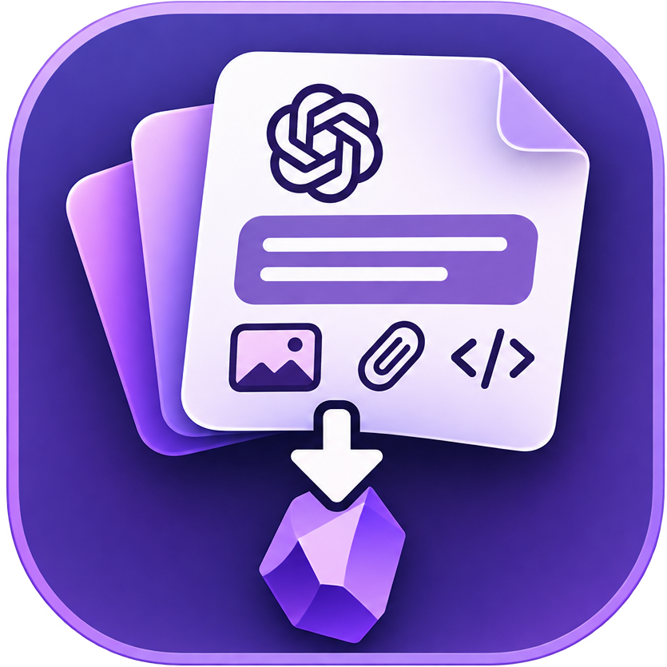

<h1 align="left">AI ChatBridge</h1>

**All your AI chats in your Obsidian vault.** AI ChatBridge mirrors your chats from **Claude**, **ChatGPT**, **Gemini**, **Google AI Studio**, **Proton Lumo** and **Hermes Agent** - plus your **Claude Code** and **Codex** sessions - into readable Markdown notes, in the same folders and projects you know from the apps. Files, images and artifacts come along too.

> [!NOTE]
> **Unofficial and read-only.** Not affiliated with, endorsed by, or supported by Anthropic, OpenAI, Google, Proton or Nous Research. Nothing is ever changed or deleted on the provider's side. The plugin reads the same web endpoints your browser uses, which can change without notice.

**New in 0.26:** [Hermes Agent](#hermes-agent) chats, with every tool step you can open. See the [changelog](CHANGELOG.md) for everything else.

## Contents

- [Highlights](#highlights)
- [What gets synced](#what-gets-synced)
- [Quick start](#quick-start)
- [How it looks in your vault](#how-it-looks-in-your-vault)
- [Choosing what to sync](#choosing-what-to-sync)
- [Multiple accounts](#multiple-accounts)
- [Desktop app sessions](#desktop-app-sessions)
- [Hermes Agent](#hermes-agent)
- [Commands](#commands)
- [Privacy and network use](#privacy-and-network-use)
- [Installation](#installation)
- [FAQ](#faq)
- [Development](#development)

## Highlights

- **Looks like the apps** - projects, recent chats, Claude Code groups and Codex projects become the same folders in your vault
- **Everything comes along** - files you uploaded, files the AI made, images and artifacts
- **Only what's new** - each sync saves new or changed chats; moving or renaming notes in Obsidian is tracked
- **Nothing is overwritten** - a changed chat gets a new `(updated …)` note next to the old one
- **Newest first** - a limited or stopped sync always has your latest chats
- **Pick what you want** - only selected projects, and a folder of your choice per project (e.g. your "Thesis" project straight into `10 Projects/Thesis`)
- **Several accounts per provider** - e.g. two Claude Pro accounts; they share one folder per provider and `account:` in each note tells them apart
- **Runs on its own** - automatic sync every 30 minutes or more, optional sync on startup, and it waits out "too many requests" (HTTP 429) pauses by itself
- **Stop anytime** - **Stop all** on the Overview, the ribbon, the status bar or any account's **Stop**; everything saved so far stays
- **Readable answers** - ChatGPT's visual answers (cards, charts, source chips) and voice chats come through as text and pictures, not "see raw JSON"

## What gets synced

| From | What | Files |
| --- | --- | --- |
| **Claude** (claude.ai) | Chats per project, plus Claude Code sessions listed on claude.ai | Artifacts and uploads |
| **ChatGPT** | Chats per project, archived chats optional; custom GPT chats go to `Recent` | Generated files and uploads |
| **Gemini** | Chats | Pictures as links |
| **Google AI Studio** | Chats and prompts | - |
| **Proton Lumo** | Chats and projects, decrypted on your computer | Coming |
| **Claude Code** (desktop app and CLI) | Sessions on this computer, in the same groups as the Code sidebar | Stay on your computer |
| **Codex** (ChatGPT desktop app and CLI) | Threads on this computer, per project | Stay on your computer |
| **Hermes Agent** | Chats on this computer, per Hermes profile, with every tool step | Stay on your computer |

## Quick start

1. Install and enable the plugin (see [Installation](#installation))
2. Open **Settings → AI ChatBridge**
3. Pick a tab - **Claude**, **ChatGPT**, **Lumo** or **Gemini** - and select **Log in**. Sign in as you would in your browser; the window closes by itself once you're in
4. Keep the default folders under `AI Chats/`, or choose your own
5. Select **Sync now**, or **Sync all** on the **Overview** tab - it shows every account and your Hermes agents at a glance

> [!TIP]
> **Max chats per run** starts at 3, so the first sync is a quick test. Set it to `0` (General tab) to sync everything.

Want local sessions too? Turn on the **Desktop app** side of a Claude or ChatGPT account for Claude Code and Codex, or a profile on the **Hermes** tab for Hermes Agent.

## How it looks in your vault

```text
AI Chats/
├── Claude/
│   ├── Chat/                          ← claude.ai chats, all accounts
│   │   ├── Recent/
│   │   │   └── 2026-11-05 Trip to Lisbon.md
│   │   └── Thesis/                    ← a claude.ai project
│   │       ├── Artifacts/…            ← files Claude made
│   │       └── Attachments/…          ← files you uploaded
│   ├── Code-Cloud/                    ← Claude Code sessions listed on claude.ai
│   └── Code-Local/
│       └── Tower/                     ← this computer's name
│           └── my-repo/               ← sidebar group or working folder
├── ChatGPT/
│   ├── Chat/
│   └── Codex-Local/
│       └── Tower/
├── Gemini/
│   ├── Chat/
│   └── AI Studio/
├── Lumo/
│   └── Chat/
└── Hermes/
    └── coder/                         ← one folder per Hermes profile

80 Archive/raw/                        ← the raw .json files, same paths as above
└── AI Chats/Claude/Chat/Recent/2026-11-05 Trip to Lisbon.json
```

Each transcript starts with properties (handy for Dataview or Bases), then the chat:

```markdown
---
account: "Main"
uuid: c_1a2b3c4d5e6f7a8b
created: 2026-09-03T09:14:54.888Z
updated: 2026-09-03T09:16:06.168Z
raw: "[[80 Archive/raw/AI Chats/Gemini/Chat/2026-09-03 Sourdough starter tips.json]]"
unread: true
---
## You · 2026-09-03 11:14

My sourdough starter smells like nail polish. Is it ruined?

## Gemini (3.6 Flash)

**No, it's just hungry.** That smell means it has used up its food. Feed it…
```

Coming from an older version? **General → Move into the new layout** shows what would move where and moves it with Obsidian's own move, so links, the sync history and the raw files follow. Folders you picked yourself stay where they are.

## Choosing what to sync

- **Project folders** - one subfolder per project, or everything in one folder
- **Only sync selected projects** - fetch your project list and tick the ones you want (chats without a project are in the list too)
- **Choose a folder per project** - under **Only sync selected projects**, give any ticked project its own folder. Empty means the default, shown greyed in the field. Folders that don't exist yet are created on the next sync. Changing a folder only affects chats synced from then on - move older ones in Obsidian and the plugin keeps track
- **Download files and images** - on or off per Claude and ChatGPT account
- **Raw files folder** - all raw `.json` files in one place (`80 Archive/raw` by default), mirroring the transcript folders; switch it off to keep them next to the transcripts
- **Automatic sync** - every 30 minutes or more. After an error it pauses until you sync by hand, so nothing runs in a loop

## Multiple accounts

On any provider tab select **Add account** and give it a name, e.g. `Work`. Each account gets its own login and saves into the same folders as your other accounts, so a project you use in both ends up in one folder. Each note has `account: "Work"` in its properties.

Two accounts can share one desktop app without anything being saved twice. A session goes:

- to the account whose **Extra session folders** hold it (handy with `CLAUDE_CONFIG_DIR` or `CODEX_HOME`)
- otherwise to the account that made it - matched by Claude organization ID or ChatGPT workspace ID, which each account fills in on its first web sync
- otherwise to the first account. Claude Code sessions run only from the CLI have no login recorded, so they end up here

A session that's already saved stays with the account that saved it.

## Desktop app sessions

Some chats only live on your computer: Claude Code sessions from the Claude desktop app and CLI (`~/.claude/projects`) and Codex threads from the ChatGPT/Codex desktop app and CLI (`~/.codex/sessions`). AI ChatBridge saves those too, one note per session.

- Titles and folders match the apps' sidebars. Claude Code sessions go in one folder per sidebar group (otherwise per working folder), with forks and side sessions nested under the session they came from. Codex threads go in one folder per project, or `Recent`
- Sessions still running wait until they have been quiet for a while (15 minutes by default)
- Session files somewhere else? Add the folder under **Extra session folders**
- Claude Cowork sessions are kept in the cloud, not on your computer, so they can't be read locally

## Hermes Agent

[Hermes Agent](https://github.com/NousResearch/hermes-agent) by Nous Research keeps every chat in a SQLite database, one per profile: `state.db` in your Hermes home folder, and `profiles/<name>/state.db` for each named profile. Chats can come from any model - Claude, GPT, a local Qwen - and each note records which one.

1. Open the **Hermes** tab. Your profiles are found by themselves (`HERMES_HOME`, else the default Hermes folder) and listed **turned off**
2. Turn on the profiles you want. Missing one? **Add by path** and point it at the folder that holds `state.db`
3. Select **Sync** next to a profile, **Sync now** for all of them, or run **Sync Hermes Agent chats**. **Sync all** includes them too

Each chat lands in `AI Chats/Hermes/<profile>/` with `source: hermes`, `hermes_profile`, `model` and `session_id` in its properties, dates as `YYYY-MM-DD`. Tool calls appear as a collapsed callout you can open:

```markdown
## Hermes · 2026-11-10 21:49

> [!example]- 3 tool steps
> **1. read_file**
> ~~~json
> { "path": "notes/garden.md" }
> ~~~
> Result:
> ~~~
> # Garden plan …
> ~~~

Lettuce, spinach and chard do well in the shade.
```

Long arguments and results are shortened (600 and 1,200 characters), so notes stay readable.

**Left out:** helper (subagent) sessions unless **Include helper sessions** is on, sessions active in the last few minutes (they come with the next sync), and anything run in - or mentioning - a folder named `Private`.

**How it reads, safely:** Hermes may be writing while you sync, and its newest messages can still sit in `state.db-wal`. So the plugin never copies the files or opens them for writing. Each sync opens `state.db` read-only, takes a consistent snapshot with SQLite's backup function into a temporary file, reads that copy and deletes it. It uses Obsidian's built-in SQLite; if your Obsidian has none, it uses Python instead - Hermes' own, or one on your computer (set it under **Hermes → Advanced → Python**).

## Commands

| Command | What it does |
| --- | --- |
| **Sync all chats** | Every account you're logged in to, then the desktop apps and Hermes profiles that are on |
| **Sync Claude chats** | All claude.ai accounts you're logged in to |
| **Sync ChatGPT chats** | All ChatGPT accounts you're logged in to |
| **Sync Gemini and AI Studio chats** | All Google accounts you're logged in to - Gemini chats, then AI Studio prompts |
| **Sync Lumo chats** | All Proton Lumo accounts you're logged in to |
| **Sync desktop app chats (Claude, Codex)** | Local Claude Code and Codex sessions |
| **Sync Hermes Agent chats** | The Hermes profiles that are on |
| **Reconcile all ChatGPT chats** | Check all ChatGPT chats again, not just recent changes |
| **Stop the running sync** | Stops after the current chat - so do **Stop all** on the Overview, the ribbon icon, the status bar text and **Stop** in the settings |
| **Cancel pending chat sync retry** | Stop a waiting retry after a 429 pause |
| **Refresh index: find synced notes moved outside the app** | Finds notes you moved in the file manager (or while the plugin was off) by their chat ID, so the next sync doesn't save them twice |
| **Move synced chats into the new folder layout** | Moves folders from older versions into `Claude/…`, `ChatGPT/…` - links, the sync index and the raw files follow |
| **Diagnose: save claude.ai answers for the open chat** | Saves the raw answers of the open chat, for bug reports |

## Privacy and network use

This plugin needs network access for the web providers. Please read this before using it.

- **Services contacted:** `claude.ai`, `chatgpt.com`, `gemini.google.com`, `aistudio.google.com` (with its API host `alkalimakersuite-pa.clients6.google.com`) and `lumo.proton.me`, plus their login pages, e.g. `auth.openai.com`, `accounts.google.com` and `account.proton.me` - only when you log in or sync. Nothing is sent anywhere else. No telemetry
- **What is sent:** the same requests your browser sends to list and read your own chats and files, with your login
- **Accounts:** you need your own account with each provider you sync
- **Login windows:** a normal sign-in page in a window of its own, locked down - pages opened there can't use your camera, microphone, location, notifications or connected devices
- **Where logins are stored:** in each login window's own storage on this computer, outside the vault, separately per account. Never in `data.json`, notes or logs. **Log out** and **Remove** in the settings clear them
- **Account identifiers:** the name you give an account, and its claude.ai organization ID or ChatGPT workspace ID, are stored in `data.json` - these are not secrets
- **Pasted login fallback (claude.ai, ChatGPT, Gemini and AI Studio):** if the login window doesn't work, you can paste a login cookie from your browser under the account's advanced settings (see the [FAQ](#faq)). It's kept in Obsidian's secret storage on this computer - never in the vault, `data.json`, notes or logs - and the login window wins if both are set. Google's cookies only go into a separate hidden window kept in memory, which is emptied after each sync. Lumo has no fallback: unlocking its encrypted chats needs keys only its login window holds
- **Gemini and AI Studio:** Google has no API for either, so the plugin opens them in a hidden window with your Google login and reads the same data their own pages load. Requests are signed inside that page the way the page signs its own - no Google token is saved or logged. Google blocks logins from windows inside apps, so the Google login window says it's Firefox
- **Proton Lumo:** Lumo stores chats end-to-end encrypted. To sync them, the plugin opens Lumo in a hidden window with your login and unlocks your keys for that one sync - the keys stay in memory and are never saved or logged. The chats are then saved **readable** in your vault, so anything that can read your vault can read them
- **ChatGPT's visual answers:** turned into plain HTML and pictures in your notes - nothing from a chat is ever run, and drawings can't load anything from other websites
- **What is written:** transcripts, raw JSON, downloaded files and a sync log - only in the vault folders you choose. The sync index in `data.json` holds chat IDs and paths, no chat content and no secrets
- **Files outside the vault (desktop apps and Hermes only):** the plugin *reads* local files only for what you turn on - for Claude Code and Codex: `~/.claude/projects`, the Claude desktop app's session list and Local Storage (for titles and sidebar groups), `~/.codex/.codex-global-state.json`, `~/.codex/sessions`, `~/.codex/archived_sessions`, `~/.codex/session_index.jsonl` and any extra folders you add; for Hermes: the `state.db` of each profile that is on. It never changes them and sends nothing over the network. Hermes snapshots are written to your system's temporary folder and deleted right after reading; if Obsidian has no built-in SQLite, a Python on your computer is started to make them. Hermes tool results can contain file contents, so they are shortened in the notes and steps mentioning a `Private` folder are left out
- **Terms of service:** automated access may be limited by the providers' terms. Keep a reasonable delay between requests and use your own judgment

## Requirements

- Obsidian **1.11.4** or newer
- **Desktop only** (Windows, macOS, Linux) - the login windows need Electron, and local sessions are read from your computer's disk

## Installation

**From Community plugins** (once accepted into the directory): **Settings → Community plugins → Browse**, search for **AI ChatBridge**, then **Install** and **Enable**.

**Manually:**

1. Download `main.js`, `manifest.json` and `styles.css` from the [latest release](https://github.com/Sundowna/obsidian-ai-chatbridge/releases/latest)
2. Copy them into `<your vault>/.obsidian/plugins/ai-chatbridge/`
3. Reload Obsidian and enable **AI ChatBridge** in **Settings → Community plugins**

## FAQ

**My first sync is taking forever?**

That's the 429s: with 1,000+ chats the providers start saying "too many requests". The plugin pauses, shows a countdown in the status bar and carries on by itself. Still a lot faster than waiting for a data export.

**The login window doesn't work for me?**

Use the pasted login fallback. Sign in to the site in your browser and open DevTools (**F12**), then:

- **claude.ai:** **Application → Cookies**, copy the value of `sessionKey`
- **ChatGPT:** **Application → Cookies**, copy the value of `__Secure-next-auth.session-token` - or, if ChatGPT split it into `.0` and `.1`, go to **Network**, select a `chatgpt.com` request and copy its whole `Cookie` header
- **Gemini and AI Studio:** **Network**, select a `gemini.google.com` request and copy its whole `Cookie` header

Paste it under the account's advanced settings in the plugin. Pasted cookies run out sooner than a login - Google's especially - so paste a fresh one when the sync says it expired.

**Can I edit the synced notes?**

Better not - treat them as the originals. Delete one and the next sync puts it back, under the same name. Write your own notes elsewhere and link to the transcript.

**Hermes says "No way to read SQLite here"?**

Your Obsidian has no built-in SQLite and no Python was found. Install Python 3 or point **Hermes → Advanced → Python** at one (Hermes ships its own in its `tools` folder).

**A sync stopped with "could not be verified"?**

The provider changed how its site answers, so the plugin stopped rather than save something wrong. Please [open an issue](https://github.com/Sundowna/obsidian-ai-chatbridge/issues) with the line from the sync log.

## Development

Requires Node.js 20 or newer.

```bash
npm install
npm run dev     # watch build to main.js
npm run build   # type check + production build
npm run lint    # eslint with eslint-plugin-obsidianmd
```

For live testing, clone the repo into `<vault>/.obsidian/plugins/ai-chatbridge/` (or copy the build output there) and reload Obsidian.

Tests run offline with made-up samples: `npm run test:gemini`, `test:lumo`, `test:desktop`, `test:hermes`, `test:inventory` and `test:sync`. `test:hermes` builds a small SQLite database in a temporary folder (set `HERMES_PYTHON` to also test the Python reader with a specific interpreter). `npm run test:offline` also reads chat exports from `samples/`, which is git-ignored because it holds real chats - add your own exports to run it.

### Releasing

1. Update `minAppVersion` in `manifest.json` if needed
2. Add a `## x.y.z - YYYY-MM-DD` section to [CHANGELOG.md](CHANGELOG.md) - it becomes the release notes
3. Run `npm version patch` (or `minor` / `major`). This bumps `package.json`, `manifest.json` and `versions.json`, commits, and creates a tag without a `v` prefix
4. Push the commit and tag: `git push --follow-tags`
5. The **Release Obsidian plugin** workflow builds the plugin and creates a draft GitHub release with `main.js`, `manifest.json` and `styles.css`, and this version's changelog as notes. Review it and publish

## Support

Found a bug or have an idea? [Open an issue](https://github.com/Sundowna/obsidian-ai-chatbridge/issues). What changed in each version is in the [changelog](CHANGELOG.md).

## License

[0BSD](LICENSE)
